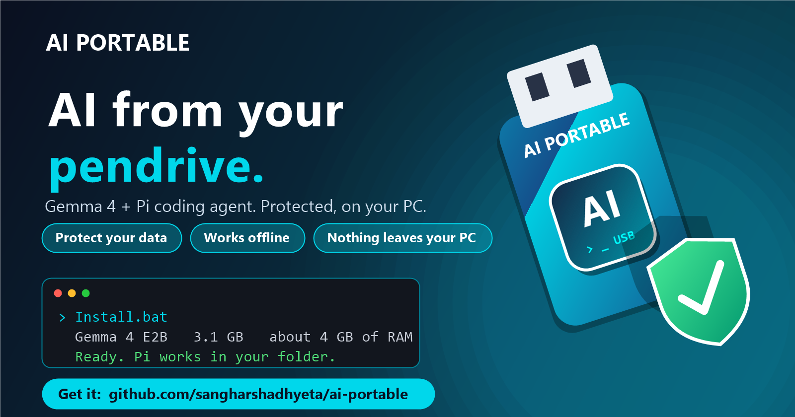
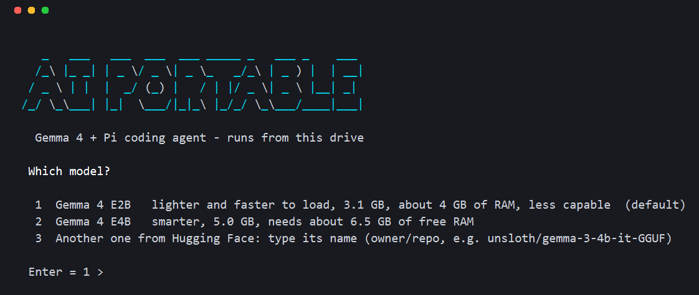
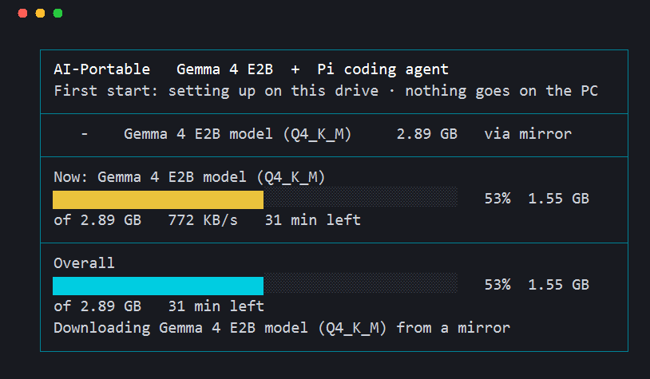
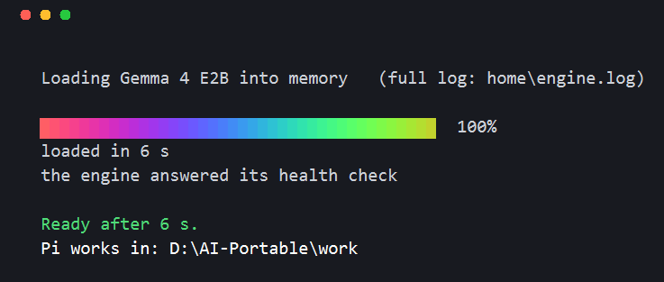
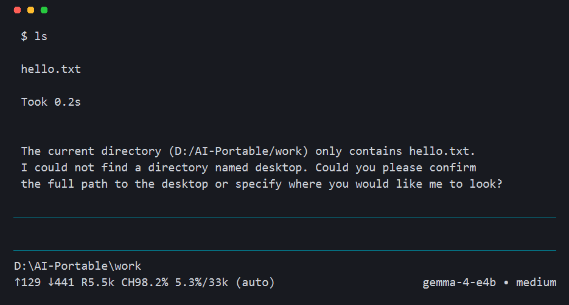

# AI-Portable

**A local coding assistant on a pendrive.** Gemma 4 runs on your PC's processor through [llama.cpp](https://github.com/ggml-org/llama.cpp), and the [Pi coding agent](https://www.npmjs.com/package/@earendil-works/pi-coding-agent) works with it in a terminal window. No account, no cloud, no install: everything lives in one folder on the drive. Windows 10/11, 64-bit.



## Safety first: it runs with protection

**Your files and prompts never leave your PC.** The model runs on your own processor, so there is no account, no API key and no cloud service to send anything to.

- **Protect your data.** Nothing you type or open is sent anywhere. Telemetry and update checks are switched off, and the engine only listens on `127.0.0.1`, so nothing on your network can reach it. After the first install it works with the internet unplugged.
- **Nothing installed, nothing left behind.** No administrator rights. The program's user, temp and app-data folders all point into the pendrive, so the PC gets no settings, history or temp files. Unplug the drive or delete the folder and it is gone. (Windows itself still notes that a USB drive was connected and that a program ran.)
- **Verified downloads.** Node.js, llama.cpp and the model are each checked against a published SHA-256 before use. The launcher is plain readable text (`Install.bat`, `bin\launch.cmd`, `bin\setup.mjs`), so you can read exactly what it does.
- **Be careful what you let the agent touch.** Pi starts in the folder you choose and can read and change files and run commands there. It is not a sandbox, and a small model can make mistakes. Pick a folder you have a copy of, keep important work backed up, and read what it proposes before you accept it.

## Get it

- **Easiest:** open the [latest release](https://github.com/sangharshadhyeta/ai-portable/releases/latest), download `AI-Portable-installer.zip` and unzip it onto your pendrive.
- **From the repository:** use **Code > Download ZIP** on the [repo page](https://github.com/sangharshadhyeta/ai-portable), or clone it straight onto the drive (replace `E:` with your drive letter):

```
git clone https://github.com/sangharshadhyeta/ai-portable E:\AI-Portable
```

Then follow the quick start below. (While the repository is private, you need to be signed in to GitHub to download.)

## Quick start

1. Copy this folder to a pendrive formatted **exFAT or NTFS** (not FAT32, which cannot hold the model file).
2. Double-click **`Install.bat`**. The first run downloads what is missing onto the drive (about 3-5 GB, each piece checked against its published SHA-256). It needs internet once.
3. Choose the folder Pi may work in when the folder window opens.
4. From then on use the **`Start`** shortcut (with the logo) that `Install.bat` puts in the folder. It works offline.

Close the window to stop everything. Dropping a folder onto `Start` skips the folder question.

## What it looks like

**First start** - the banner, then the model choice:



**Setting up on the drive** - real byte sizes, one bar for the current download and one for the whole job:



**Loading the model** - llama.cpp's own log, then Pi starts in the folder you chose:



**Pi at work:**



> The images are rendered from the real terminal text of these screens (colours approximated), not pixel captures.

## Choosing the model

Every start asks which model to use. The list is ordered by **last used** (the one you used last is number 1, so Enter picks it), and it shows what is already on the drive and what can be downloaded:

```
   1  Gemma 4 E2B       on this drive    lighter and faster to load, about 4 GB of RAM, less capable
   2  Gemma 4 E4B       download 5.0 GB  smarter, needs about 6.5 GB of free RAM
   3  Another one from Hugging Face: type its name (owner/repo)
```

- **E2B** (3.1 GB) is the default on a first start; **E4B** (5.0 GB) is smarter but needs more RAM.
- **Any GGUF model on Hugging Face:** type its name as `owner/repo` (or pick the last line and type it), then choose a file. Its size and SHA-256 are taken from Hugging Face and checked after the download. Use an instruct ("it") model with a chat template and a single `.gguf` file; multi-part files are not offered.
- A model you download this way is remembered and appears in the list from then on. A `.gguf` file you copy into `models\` by hand is listed too.
- The list and the order are kept in `home\models.json`.

## System requirements

| | |
|---|---|
| **Windows** | 64-bit Windows 10 (1803 or newer) or Windows 11. `curl.exe` and `tar.exe` must be present (they come with Windows 10 1803+). |
| **Processor** | Any 64-bit Intel/AMD processor with AVX (about 2011 or newer; AVX2 is faster). 4+ cores is better. No graphics card needed. |
| **RAM** | 8 GB minimum, 16 GB recommended. About 4 GB (E2B) or 6.5 GB (E4B) should be **free** when you start: close browsers first. With less free RAM it uses a shorter context (8K instead of 32K). |
| **Pendrive** | 5-7 GB free, exFAT or NTFS. USB 3 or faster is strongly recommended: each start reads the model from it. |
| **Internet** | Only for the first install. |
| **Not needed** | Administrator rights, installing anything, Python, a graphics card. |

## Speed

Measured with E4B on a Ryzen 7 7735U laptop (16 GB, USB drive): about **6.7 tokens/s** when writing, **35 tokens/s** reading the prompt, and a first start of about **4 minutes** while the model is read from a slow drive. E2B is smaller, so it loads faster and answers faster.

## Good to know

- **Small models are limited.** They are good for reading and explaining files, small edits, short scripts and single commands, and can lose their way on long multi-step tasks.
- **Pi can read and change files** in the folder you choose. Pick it deliberately.
- **Closing the window frees the RAM.** Quitting Pi, pressing Ctrl+C or closing the terminal window stops the engine and releases the model from memory (a tiny hidden watcher ends the engine within about a second even if the window is closed abruptly). A leftover engine from an older run is also ended on the next start. To free the RAM by hand: `taskkill /IM llama-server.exe /F`.
- **The loading screen shows measured values only:** a rainbow bar of how much of the model is in memory or has been read from the drive, the live drive read speed, the engine's memory, and llama.cpp's latest log line. If nothing moves for 20 seconds it says the drive is slow (not that something broke).

## What gets downloaded (into the folder)

| Folder | Content |
|---|---|
| `engine\` | llama.cpp b12180, Windows x64 CPU build (MIT licence) |
| `node\` | Node.js v26.13.0 (MIT licence) |
| `pi\` | Pi coding agent 1.5.0, `@earendil-works/pi-coding-agent` (MIT licence) |
| `models\` | the Gemma 4 GGUF by NobodyWho, or the model you chose (see its own licence; Gemma terms of use) |
| `home\` | Pi's settings and history, logs, temp files |
| `work\` | Pi's default working folder |

## Files in this repository

`Install.bat` and `bin\launch.cmd` (fetch Node.js with Windows' own curl/certutil/tar), `bin\setup.mjs` (everything else: one screen, downloads, engine, Pi), `bin\logo.txt` / `bin\logo.ico`.
